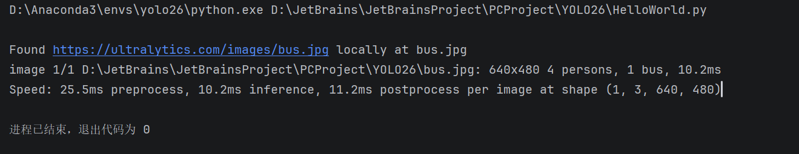
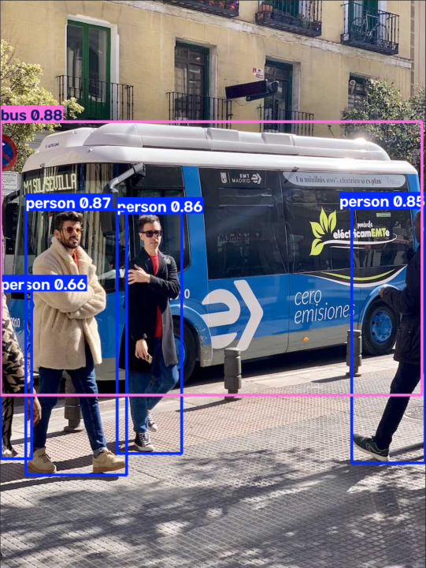
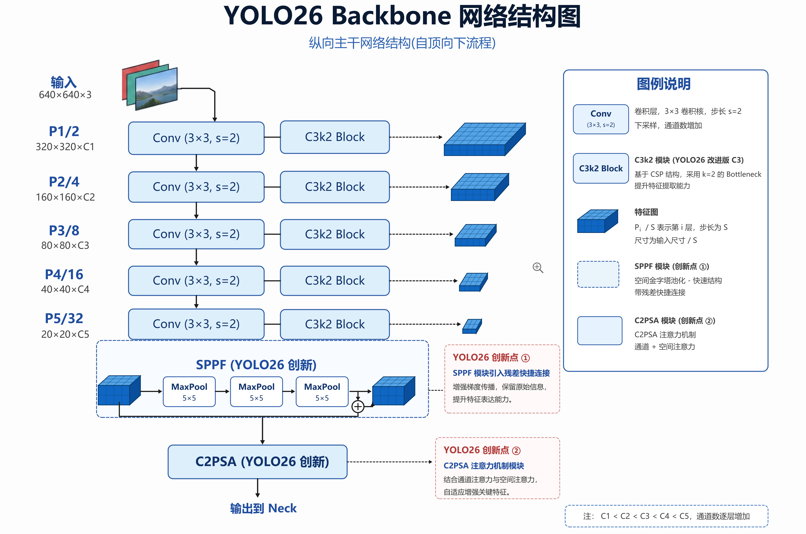
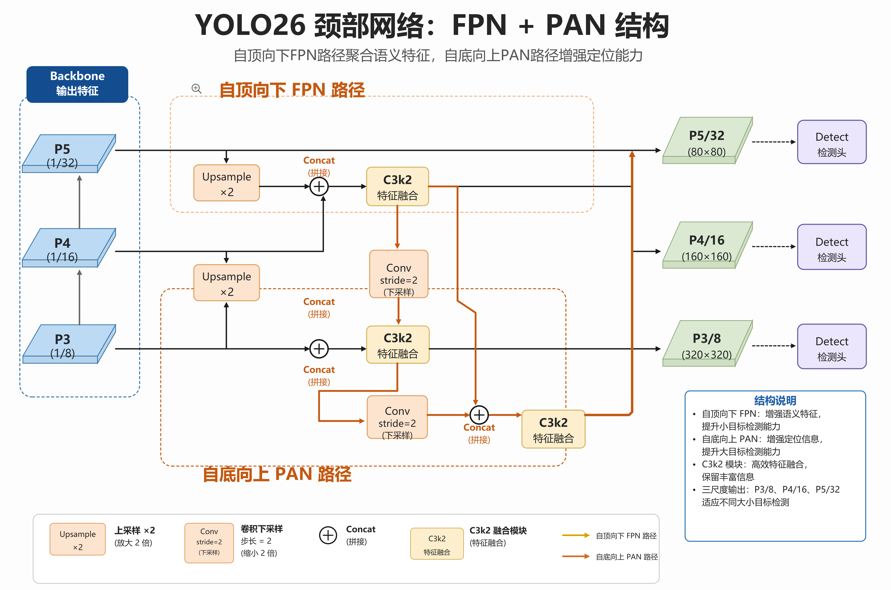
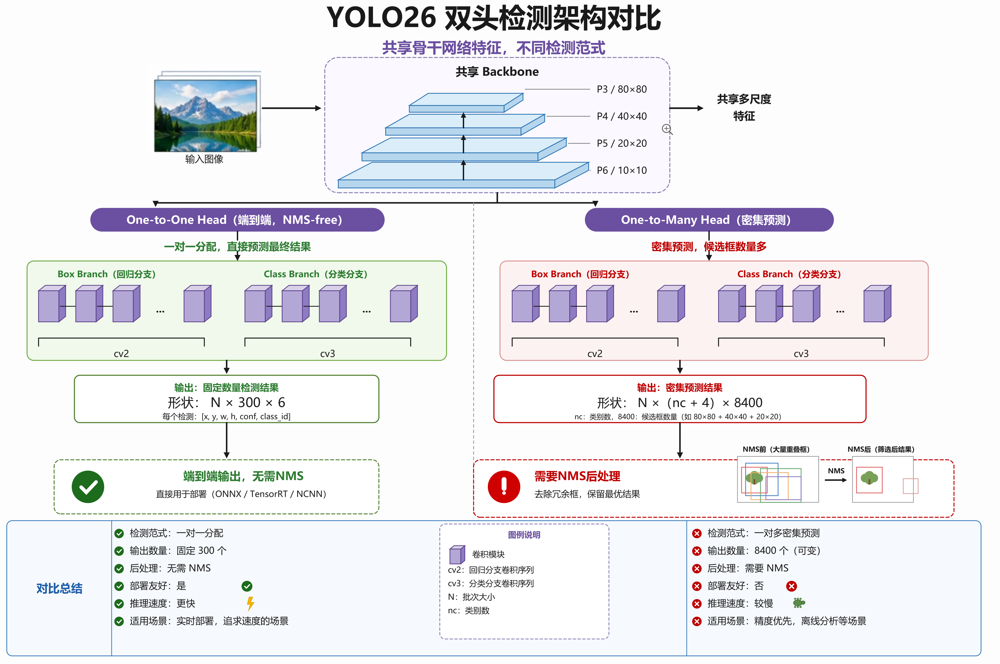

# YOLO笔记

## 一、YOLO 发展历程

### 1.YOLO的出现

​	 YOLO出现之前目标检测领域存在一个问题：精度尚可但太慢、无法实时，当时主流的 R-CNN 系列走的是两阶段路线：2014 年 R-CNN 先找候选区域再逐个分类，2015 年 Faster R-CNN 进一步优化，但整体流程依然重、速度依然受限。

​	于是在2016年，Joseph Redmon 等人在 CVPR 上正式提出 YOLO，把检测当作单一回归问题，用一整张图直接输出物体位置和类别，基础版达到 45 FPS、精简版 Fast YOLO 达到 155 FPS，首次让深度学习目标检测真正跑进了实时区间。

​	但是这种思路也存在一个问题：定位精度和召回率不如两阶段方法，而后续每一个版本都是在补这个初始方案留下的短板。

### 2.YOLO的发展

- **YOLOv1（2015/2016，Joseph Redmon）：用回归换速度，但精度欠佳**

  **问题**：当时主流的目标检测方法（如 R-CNN 系列）是“两阶段”的：先找出可能含有物体的区域，再对每个区域分类。这种做法精度尚可，但速度很慢，难以实时。

  **方案**：Joseph Redmon 等人提出把检测当作一个回归问题来处理。用单个神经网络直接从整张图预测边界框的位置和类别，不再需要单独的区域建议步骤。在 Pascal VOC 上，YOLOv1 达到 45 FPS，精简版 Fast YOLO 甚至到 155 FPS，速度是 Faster R-CNN 的数倍。

  **留下的问题**：速度上去了，但定位精度差，对小物体的检测效果很不好，召回率也偏低。YOLOv1 证明了单阶段检测可行，但还不够好用。


- **YOLOv2（2016/2017，Joseph Redmon）：补定位和召回的课**

  **问题**：YOLOv1 速度快但定位不准、召回率低。

  **方案**：YOLOv2 系统性地做了几件事来补短板。引入 Batch Normalization 提升收敛和正则化效果；用更高分辨率（448×448）做分类预训练，让网络适应更清晰的输入；去掉全连接层，改用 Anchor Boxes 来预测边界框，大幅提升召回率；先验框的尺寸不再手工设定，而是用 K-means 聚类从训练数据中统计出来。网络也换成了更高效的 Darknet-19。召回率从 YOLOv1 的 81% 提升到 88%。

  **留下的问题**：召回率上去了，但 mAP 并没有同步大涨，精度仍然有限，尤其面对不同尺度的物体时依然吃力。


- **YOLOv3（2018，Joseph Redmon）：多尺度检测，专治小物体**

  **问题**：YOLOv2 对小物体的检测仍然不够好，单一尺度的预测难以覆盖大小差异巨大的目标。

  **方案**：YOLOv3 的核心改动是多尺度预测。它借鉴了特征金字塔的思路，在不同深度的特征图上分别做检测：浅层特征图分辨率高，负责小物体；深层特征图语义强，负责大物体。骨干网络换成了更深的 Darknet-53，引入残差结构来支撑更深的网络。分类器也从 softmax 换成了 logistic，以支持多标签场景。在保持速度优势的同时，精度有明显提升。

  **留下的问题**：模型变大了，结构也更复杂。YOLOv3 是 Redmon 主导的最后一个版本，此后 YOLO 的学术路线和工程路线开始分岔。


- **YOLOv4（2020，Alexey Bochkovskiy / 王建尧 / 廖弘源）：在工程约束下找最优平衡**

  **问题**：实际应用（如交通监控）需要**又快、又准、又能塞进小型计算设备**的检测器。YOLOv3 还有优化空间，但需要在有限的算力预算内把精度推上去。

  **方案**：YOLOv4 由俄罗斯的 Alexey Bochkovskiy 与台湾中研院的王建尧、廖弘源合作完成。它没有发明一个全新的范式，而是系统性地组合和调优了大量已有技术：CSPDarknet-53 骨干、Mosaic 数据增强、SPP 与 PAN 结构、CIoU 损失等。目标是让模型在常规 GPU 上训练、在普通设备上推理时达到速度和精度的最佳平衡。在 COCO 上，YOLOv4 的 AP 达到 43.5%，比 YOLOv3 高出约 10 个百分点。


- **YOLOv5（2020，Ultralytics）：让 YOLO 从论文变成工具**

  **问题**：YOLOv4 精度很好，但基于 Darknet 框架，对大量使用 PyTorch 的开发者来说，上手和部署的门槛偏高。

  **方案**：Glenn Jocher 创立的 Ultralytics 用 PyTorch 重写了 YOLO，推出了 YOLOv5。这一版的工程意义远大于算法创新：它提供了简洁的 Python 接口、模块化的设计、预训练权重的自动下载，让开发者可以真正“拿来就用”。YOLOv5 也提供了 n/s/m/l/x 多种尺寸，延续了速度与精度的可调节性。从这一版开始，YOLO 的维护和迭代主导权转移到了 Ultralytics 手中。


- **YOLOv8（2023，Ultralytics）：从检测器变成多任务框架**

  **问题**：用户不再只满足于“框出物体”。实际项目里经常需要分割轮廓、找关键点、做分类，如果每个任务都要另找一套框架，成本很高。

  **方案**：YOLOv8 把 YOLO 扩展成了一个统一的多任务框架。它支持检测、实例分割、姿态估计、图像分类，并且每种任务共享一致的调用方式和模型体系。检测头改成了 Anchor-free 设计，简化了流程。出现了 `yolov8n-seg.pt`、`yolov8n-pose.pt` 等后缀模型。这意味着 YOLO 不再是一个“检测算法”，而是一个视觉任务的工具箱。


- **YOLO11 / YOLO26（2024 及之后，Ultralytics）：继续补短板，走向端到端**

  **问题**：多任务框架有了，但不同任务、不同部署场景对精度和延迟的要求差异很大。有的场景需要更高的召回率，有的场景需要极低的推理延迟和更简单的部署流程。

  **方案**：YOLO11 重新设计了骨干和颈部结构（如 C3k2 模块、空间注意力），在提升特征提取能力的同时控制参数量，并保持对现有生态的兼容。到了 YOLO26，Ultralytics 进一步去掉了 NMS（非极大值抑制）后处理，走向端到端推理，以降低延迟、简化部署。同时任务矩阵扩展到了 7 种，新增了语义分割和深度估计。这一阶段的迭代方向，已经从“检测得更准”转向了“在更多任务、更多硬件上都能跑得好”。

## 二、YOLO中的模型

​	自 YOLOv8 起，YOLO 已从单一检测模型发展为统一的多任务视觉工具箱。该框架将检测、分割、姿态估计、分类等不同视觉能力整合进同一套调用体系，开发者通过替换文件名后缀即可切换任务类型，无需维护多套独立代码库。

​	在此框架下，每种任务都有专精于该任务的模型变体，而每个任务模型又提供 n、s、m、l、x 五种尺寸规格，在参数量、计算量与推理速度之间形成梯度，供开发者根据硬件条件和延迟预算灵活选择。

​	以当前 YOLO26 为例，其统一框架完整覆盖七种任务：目标检测、实例分割、语义分割、深度估计、图像分类、姿态估计以及旋转框检测，每种任务均具备完整的 n/s/m/l/x 五尺寸矩阵，共 35 个可调用的预训练模型文件。

### 1.YOLO26 模型尺寸（n/s/m/l/x）详解

| 标识 | 含义                | 典型使用场景                                               |
| ---- | ------------------- | ---------------------------------------------------------- |
| n    | Nano（纳米）        | 手机、树莓派、浏览器等小型边缘设备；延迟预算紧张的场景     |
| s    | Small（小）         | 笔记本/桌面 CPU 追求 10–30 FPS；或 n 有余量时升级          |
| m    | Medium（中）        | 单 GPU 实时视频处理；精度与速度的平衡点                    |
| l    | Large（大）         | 离线批处理或精度优先场景；从 m 到 l 的精度增益有限，需权衡 |
| x    | Extra Large（超大） | 精度绝对优先、不计较推理耗时的离线任务                     |

### 2.如何衡量5个模型尺寸的档位差异

- **参数量（Params，单位 M）**：模型内部可学习参数的数量，以百万计。
- **计算量（FLOPs，单位 B）**：处理一张图所需的浮点运算次数，以十亿计。
- **精度（mAP 或 mIoU）**：模型在验证集上的准确率表现。
- **推理速度（ms）**：在特定硬件（如 CPU 或 GPU）上的耗时。

#### 以 YOLO26 检测任务为例，从 n 到 x 的取值变化范围如下：

| 尺寸 | 参数量 (M) | 计算量 (FLOPs, B) | 精度 mAP50-95 | CPU 耗时 (ms) |
| ---- | ---------- | ----------------- | ------------- | ------------- |
| n    | 2.4        | 5.5               | 40.9          | 38.9          |
| s    | 9.5        | 20.9              | 48.6          | 87.2          |
| m    | 20.4       | 68.4              | 53.1          | 220.0         |
| l    | 24.8       | 86.8              | 55.0          | 286.2         |
| x    | 55.7       | 194.4             | 57.5          | 525.8         |

### 3.YOLO七种任务类型汇总

| 任务类型          | 模型名称（以 n 尺寸为例，其余替换字母即可） | 定义                                               | 主要特征                                                | 适用场景                             |
| ----------------- | ------------------------------------------- | -------------------------------------------------- | ------------------------------------------------------- | ------------------------------------ |
| 目标检测          | `yolo26n.pt` 等                             | 识别图像/视频帧中的物体，并用边界框标出位置与类别  | YOLO26 的基础任务；输出水平边界框；速度快，适合实时应用 | 监控系统、自动驾驶                   |
| 实例分割          | `yolo26n-seg.pt` 等                         | 在检测基础上，为每个独立物体生成像素级掩码         | 区分同类物体的不同个体；输出精确轮廓                    | 医学影像、农业分析、制造质检         |
| 语义分割          | `yolo26n-sem.pt` 等                         | 为图像中每个像素分配类别标签，生成稠密类别图       | 不区分同类个体；输出整幅场景的像素级类别地图            | 自动驾驶场景理解、土地覆盖制图       |
| 深度估计          | `yolo26n-depth.pt` 等                       | 从单张 RGB 图像预测每个像素的深度（距离，单位米）  | 输出稠密浮点深度图；仅需单目相机                        | 3D 场景重建、机器人导航、AR/VR       |
| 图像分类          | `yolo26n-cls.pt` 等                         | 判断整张图像属于什么类别                           | 不定位物体位置；输出图像级类别标签                      | 电商商品分类、内容审核、野生动物监测 |
| 姿态估计          | `yolo26n-pose.pt` 等                        | 检测图像中特定关键点（如人体关节、面部特征）       | 输出关键点坐标；用于动作跟踪与姿态判断                  | 健身动作分析、体育分析、人机交互     |
| 旋转框检测（OBB） | `yolo26n-obb.pt` 等                         | 在传统检测基础上增加方向角度，用旋转框定位倾斜物体 | 边界框可带角度；专门处理任意朝向的目标                  | 航拍图像分析、遥感、文档处理         |

## 三、YOLO代码入门

### 1.安装YOLO

​	这里建议去用miniconda创建虚拟环境安装，如果不会的话去网上找找conda相关教程。

### 2.第一个YOLO程序

```python
from ultralytics import YOLO
#加载预训练模型（会自动下载）

model = YOLO("yolo26n.pt")
# model = Y0L0("yolo26s.pt")

# 对一张图片进行推理
results = model("https://ultralytics.com/images/bus.jpg")
#显示带有检测框的结果
results[0].show()
```

**控制台输出如下：**


```
Speed: 25.5ms preprocess, 10.2ms inference, 11.2ms postprocess per image at shape (1, 3, 640, 480)
```

这个输出是YOLO26在推理一张图片时打印的性能日志，它告诉你了模型处理这张图片总共花了多少时间，以及每个环节分别用了多久。我们把它拆开来看：

------

#### 三个时间阶段：

- **Preprocess （预处理）— 25.5ms**
  - 这是模型“读懂”图片前的准备工作。YOLO需要把输入的原始图片（可能是任意尺寸、格式）统一缩放、归一化、转为模型能识别的张量格式。
  - 这里的25.5ms表示这个转换过程只花了25.5毫秒，非常快。


- **Inference （推理） — 10.2ms**
  - 这是最核心的计算阶段。模型把预处理后的图片“喂”给神经网络，进行前向传播，得到原始检测结果（比如数百个候选框和分类分数）。
  - 10.2ms是模型“思考”并输出原始结果所用的时间。这个时间主要取决于模型的大小（如yolo26n最快，Yolo26x最慢）和硬件（CPU/GPU）性能。对于一般的边缘设备（如CPU），这个速度已经相当不错了。


- **Postprocess（后处理） —11.2ms**
  - 这是对推理原始结果进行“精加工”的步骤。传统YOLO需要在这里执行非极大值抑制（NMS）来去除重复框，这一步往往耗时且不稳定。
  - 但YOLO26的一大革新就是“端到端无NMS”，所以它的后处理极其轻量，只需要做简单的阈值过滤和格式整理。11.2ms正体现了这一优势，几乎可以忽略不计。

------

#### 关于输入尺寸 `(1, 3, 640, 480)`

这四维数字表示模型实际接收的图片张量维度：

- `1`：**批次大小**，即一次只处理了一张图片。
- `3`：**颜色通道数**，RGB三通道。
- `640`：**图片高度**（像素）。
- `480`：**图片宽度**（像素）。

------

#### 总耗时与性能评价

- **总计耗时**≈25.5+10.2+11.2=**46.9ms**，意味着每秒大约可以处理**21张图片**（1000ms/46.9ms ≈21FPS）。
- 这个速度对于大多数实时应用（如视频监控、无人机巡检）**完全够用**。如果是在GPU（如NVIDIAT4）上，这个数值会更低（可能小于10ms）；在CPU上，41.2ms推理时间说明YOLO26的优化非常出色。
- 本代码为第一次跑，故后处理时间有点长，往往后处理**只有0.3ms**，这直接证明了YOLO26“无NMS”设计带来的效率提升——传统模型的后处理往往需要5~10ms，甚至更多。

------

#### 识别图片结果



这些数字（如0.88、0.87）在目标检测中叫作**置信度分数（Confidence Score）**。

你可以把它直接理解为**模型对自己判断的“把握程度”**，或者**“蒙对的概率”**。它是一个介于**0和1之间**的数值。

YOLO26默认可以识别的物体种类和单张图像最多检测出的物体数量，是两个不同的概念。

- 可识别的物体类别：默认是80种。这些类别来自COCO数据集，覆盖了常见的人、车、动物等日常物体。
-  单张图像最多检测数量：默认是300个。这得益于其默认的“一对一头”架构，能直接输出最多300个筛选后的检测结果，无需额外的后处理步骤。

## 四、YOLO26模型架构解析

### 1.整体架构：Backbone→Neck→Head

YOLO26 与所有Ultralytics YOLO模型一样，遵循经典的三段式流水线：


### 2.骨干网络Backbone详解

Backbone 负责从输入图像中提取多尺度语义特征，YOLO26的骨干继承YOLO11 设计并做了SPPF残差增强。



*上图：YOLO26 骨干网络一 逐层下采样+ C3k2 特征提取+SPPF 空间池化+ C2PSA注意力*

#### 2.1 各阶段详解

| 层索引 | 模块         | 输出尺度 | 通道数  | 作用        |
| ------ | ------------ | -------- | ------- | ----------- |
| 0      | Conv s=2     | P1/2     | 64      | 初始下采样  |
| 1-2    | Conv + C3k2  | P2/4     | 128→256 | 浅层特征    |
| 3-4    | Conv + C3k2  | P3/8     | 256→512 | 小目标特征⭐ |
| 5-6    | Conv + C3k2  | P4/16    | 512     | 中目标特征⭐ |
| 7-8    | Conv + C3k2  | P5/32    | 1024    | 大目标特征⭐ |
| 9      | SPPF（残差） | P5/32    | 1024    | 扩大感受野  |
| 10     | C2PSA        | P5/32    | 1024    | 全局注意力  |

> P3、P4、P5三个尺度的特征图会被 Neck和 Head 共同使用。P3负责小物体，P5负责大物体。

#### 2.2 基础单元Conv

所有大模块的基础单元是 **Conv 块**（定义于conv.py）：

```
Conv = Conv2d → BatchNorm → SiLU
```

- **Conv2d**：标准 2D 卷积
- **BatchNorm**：批归一化，稳定训练
- **SiLU**（Swish）:平滑激活函数，`x· sigmoid(x)`

#### 2.3 SPPF残差连接（YOLO26新增）

SPPF（Spatial Pyramid Pooling- Fast）通过串联 3 次 MaxPool（kernel=5）等效于 SPP(k=5,9,13)，但计算量更低。

**YOLO26的创新**：在SPPF输出端增加残差连接：

```python
# YOL026 SPPF 伪代码
def forward(self, x):
y = self.cv2(torch.cat([x, pool(x), pool²(x), pool³(x)], dim=1))
return y + x # ← YOLo26 新增残差 shortcut
```

当 `c1 == c2 == 1024`时，输入输出通道一致，可以直接相加。这有助于：

- 缓解深层网络的梯度消失
- 保留原始空间信息

### 3.颈部网络Neck：FPN+PAN

Neck的核心任务是让不同尺度的特征图互相融合，使小物体也能获得大感受野的语义信息，大物体也能保留精细的空间定位。



*图：Neck的FPN（自顶向下）+PAN（自底向上）双向融合路径*

#### 3.1 FPN：自顶向下（Top-Down）

FPN将高层语义信息传递到低层：

```
P5 (1024ch) ——Upsamp1e×2——
                           |— Concat — C3k2 ——→ 融合 P4
P4 （512ch）——————————————

融合 P4 —-Upsamp1e×2——
                       |—— Concat————C3k2————→融合 P3（小目标）
P3 (512ch)————————————
```

**作用**：让P3特征图”看到"全局语义，提升小目标检测能力。

#### 3.2 PAN：自底向上（Bottom-Up）

PAN 将低层定位信息传递回高层：

```
融合 P3—————Conv s=2—
                     |————Concat — c3k2 —→ 增强 P4
融合 P4——————————————

增强 P4 ——Conv s=2—
                   |————Concat — C3k2 —→ 增强 P5 （大目标）
P5 (1024ch)————————
```

**作用**：让P5特征图保留精细空间细节，提升大目标定位精度。

#### 3.3 Neck 输出

Neck最终输出三个融合特征图，分别送入Detect头：

| 输出 | 尺度  | 步长 | 适合检测            |
| ---- | ----- | ---- | ------------------- |
| 层16 | P3/8  | 8    | 小物体（< 32×32px） |
| 层19 | P4/16 | 16   | 中等物体            |
| 层22 | P5/32 | 32   | 大物体（>96×96px）  |

### 4.检测头Detect：双头设计与端到端推理

YOLO26检测头最大的架构变革是引入**双头（Dual-Head）**设计，实现原生NMS-Free推理。



*图：YOLO26 双头检测— One-to-One （推理）与One-to-Many（训练辅助）*

#### 4.1 解耦头结构

每个金字塔层级上，Detect头运行两个**并行分支**：

```
特征图———————Box Branch (cv2): Conv 3×3 + Conv 3×3 → Conv2d（4, 1×1）
        |          输出：4 个坐标（x，y，w，h） - 直接回归，无 DFL
        |
        ————Class Branch (cv3): DwConv + Conv 1×1 → DwConv → Conv2d（nc, 1×1）
                   输出：nc 个类别分数
```

- **Box Branch**：层卷积，最终输出4 通道（直接坐标回归）
- **Class Branch**：深度可分离卷积（DWConv），更轻量

#### 4.2 One-to-One Head（默认推理头）

| 属性        | 值                               |
| ----------- | -------------------------------- |
| 输出形状    | （N，300，6）                    |
| 最大检测数  | 300个/图                         |
| 是否需要NMS | 否                               |
| 标签分配    | TAL topk=7 → topk2=1 （唯—匹配） |

每个真实目标只对应一个预测，模型内部自行处理重复框，推理时直接输出最终结果。

#### 4.3 One-to-Many Head（训练辅助头）

| 属性        | 值                         |
| ----------- | -------------------------- |
| 输出形状    | (N, nc+4, 8400)            |
| 锚点数      | 8400 (80×80+40×40 + 20×20) |
| 是否需要NMS | 是                         |
| 标签分配    | TAL topk=10（多正样本）    |

提供更丰富的正样本监督，帮助One-to-One头学习更好的特征表示。

#### 4.4 双头设计的优势

```
训练阶段: One-to-Many （密集监督）+ One-to-One （端到端监督）
                 ↓ Progressive Loss 渐进过渡
推理阶段: 仅使用 One-to-One + 无 NMS → 更快更简单
```

这是一个**精度-速度旋钮**：追求极致精度可选One-to-Many+NMS；追求部署简洁则用One-to-One。